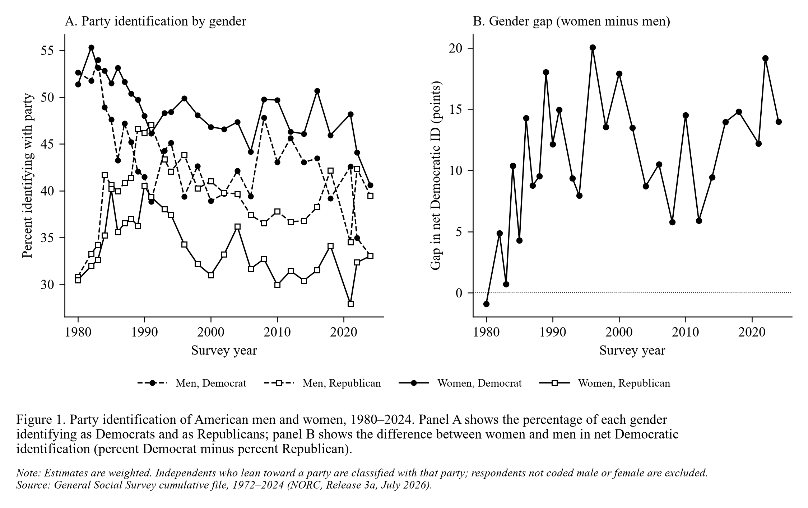

# ps158-reproduce

Class section assignment.



**Figure:** Figure 1, *Party identification of American men and women, 1980–2024*.
Panel A shows the share of men and women who identify as Democrats and as Republicans.
Panel B shows the gender gap in net Democratic identification (% Democrat − % Republican,
women minus men). Independents who lean toward a party are counted with that party, and
all estimates are weighted.

**Data:** [General Social Survey cumulative file, 1972–2024](https://gss.norc.org/get-the-data/stata.html)
(NORC, Release 3a, July 2026), variables `year`, `sex`, `partyid`, weight `wtssps`.
2024 is the most recent survey available. `get_data.py` downloads the Stata file from
gss.norc.org and writes the cleaned extract to `data/gss_gender_party.csv`. The raw
~600 MB file isn't committed because it's too big for GitHub.

## Run it

```
pip install -r requirements.txt
python get_data.py    # download and clean the GSS
python plot.py        # draw figure.png / figure.pdf
python validate.py    # optional: check the data (see below)
```

## How close it gets

`validate.py` checks the data against the original source:

- The 2024 counts of `sex` and `partyid` match NORC's published 2024 codebook exactly.
- Every raw respondent is either in the cleaned file or dropped for a stated reason:
  other party, missing party ID, or missing sex.
- The plotted shares match a separate recomputation from the raw file.
- The gender gap changes by 0.4 points on average with NORC's non-response-adjusted weight,
  and by 1.7 points unweighted.

## What it shows

- The gap opened in the 1980s, mostly because men moved away from the Democrats.
  Men's net Democratic margin fell from +9 in the 1980s to −2 in the 1990s; women's
  fell from +17 to +11.
- Since then the gap has held at about 11–13 points per decade. In 2021–24 it was 15
  points, the largest decade average, but single-year estimates carry roughly ±9 points
  of sampling error.

## Caveats and next steps

- From 2021 the GSS records sex differently and is fielded mostly on the web, so
  compare 2021–24 with earlier years cautiously.
- The [ANES Cumulative Data File](https://electionstudies.org/data-center/anes-time-series-cumulative-data-file/)
  (1948–2024) is the field's standard source and would be a check on these results.
  Its site blocks scripted downloads, so download the CSV by hand into `data/raw/`;
  `get_data.py` and `plot.py` then add it to the figure automatically.
- Next: add confidence bands and break the gap down by education, marital status,
  race and age cohort.
